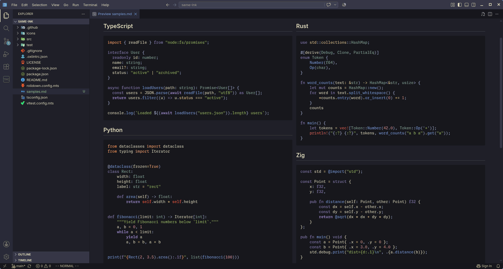

# Same Ink

  
  &nbsp;&nbsp;
  
  &nbsp;&nbsp;
  
  &nbsp;&nbsp;
  

VS Code's built-in Markdown preview colors code blocks with its own fixed light and dark palettes, ignoring your editor theme, so snippets in the preview never quite match the code you're writing.

Same Ink highlights code blocks in VS Code's Markdown preview with **your current editor color theme**, so snippets in the preview look the same as in the editor.

## Features

- Uses the exact token colors of the active theme, built-in or installed from an extension.
- Follows theme switches, including automatic light/dark switching (`window.autoDetectColorScheme`).
- Loads language grammars on demand: a block in a new language appears plain for a moment, then the preview refreshes with highlighting.
- Leaves the code block background and border to the preview, so blocks use the theme's `textCodeBlock.background` and stay distinct from the page.

Works with all popular themes, dark or light.

Highlighting is done by [Shiki](https://shiki.style), which supports [200+ languages](https://shiki.style/languages).

## Usage

No settings, no commands: install the extension and open any Markdown preview (`Ctrl+Shift+V`). Your code blocks now match your theme.

## Limitations

- Themes that use the legacy `.tmTheme` format only contribute their base colors, not token colors.
- The preview follows the theme you select, not the themes you hover over in the theme picker.
- Semantic highlighting from language servers isn't available in the preview, so colors match the editor's TextMate highlighting.

## License

[MIT](LICENSE)
